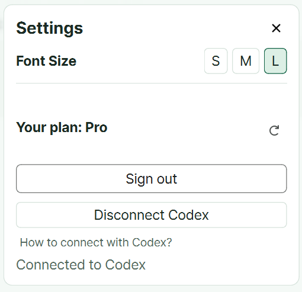
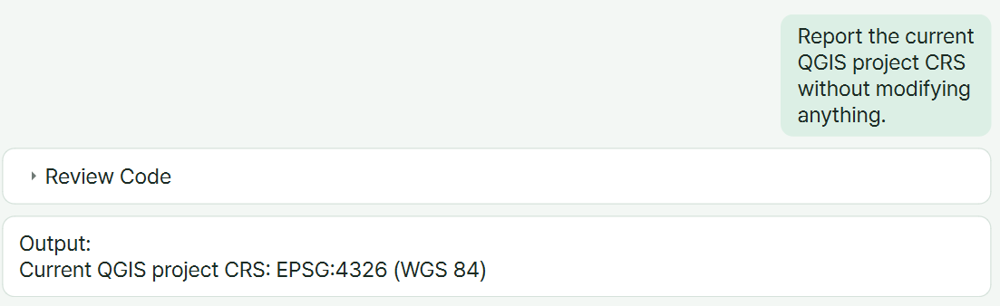

# QueryGIS for Codex

[English](README.md)

같은 Windows PC에서 실행 중인 QGIS의 QueryGIS를 Codex에 연결합니다. 연결하면 Codex에서 현재 프로젝트에 대해 질문하거나 GIS 작업을 요청할 수 있습니다. Codex용 플러그인은 이 저장소에서 PC에 직접 설치합니다.

## 준비물

- Windows에 Codex 데스크톱 앱을 설치하고 실행하세요. Codex에서는 **로컬 채팅**을 사용합니다.
- [Git for Windows](https://git-scm.com/install/windows)와 [Python 3.11 이상](https://www.python.org/downloads/windows/)을 설치하세요. PowerShell에서 `git`, `python`, Codex CLI의 `codex` 명령을 실행할 수 있어야 합니다.
- QGIS에 **QueryGIS 1.9.16 이상**을 설치하고 활성화하세요. QueryGIS에서 **Pro 요금제를 이용 중인 Google 계정**으로 로그인하세요.
- QGIS와 Codex는 같은 Windows 사용자 계정에서 실행하세요.

## 1. Codex에 설치 요청하기

저장소 주소를 포함해 아래 내용을 통째로 복사하고, Codex의 로컬 채팅에 붙여넣으세요.

```text
https://github.com/hongbumm/QueryGIS_with_Codex

이 저장소의 QueryGIS 플러그인을 내 Windows Codex에 설치해줘. 저장소는
계속 사용할 수 있는 폴더에 복제하고, README와 scripts/setup.ps1을 확인한
뒤 저장소 폴더에서 .\scripts\setup.ps1 -CodexOnly를 실행해줘.
querygis@querygis-local이 설치됐는지 확인하고, 설치가 끝나면 QGIS에서
연결하는 방법을 알려줘.
```

Codex가 명령 실행 승인을 요청하면 확인하고 승인하세요. 설치 과정에서 만든 Python 환경을 계속 사용하므로 저장소를 복제한 폴더는 그대로 두세요.

<details>
<summary>PowerShell에서 직접 설치</summary>

저장소를 보관할 상위 폴더에서 다음 명령을 실행하세요.

```powershell
git clone https://github.com/hongbumm/QueryGIS_with_Codex.git
Set-Location QueryGIS_with_Codex
.\scripts\setup.ps1 -CodexOnly
```

`-CodexOnly`는 Codex 쪽 플러그인을 설치합니다. QGIS 연결 기능은 QueryGIS 1.9.16 이상에 포함되어 있습니다.

</details>

## 2. QGIS에서 연결하기

1. QGIS의 **QueryGIS** 패널에서 설정 톱니바퀴를 누른 뒤 **Connect with Codex**를 클릭하세요. 연결을 기다리는 동안 QGIS를 열어두세요.
2. 플러그인이 로드되도록 Codex에서 **새 로컬 채팅**을 여세요. 플러그인이 보이지 않으면 Codex를 다시 시작하고 **Plugins**의 로컬 QueryGIS 마켓플레이스에서 **QueryGIS**를 확인하세요.
3. Codex에 아래처럼 요청하세요.

   ```text
   QueryGIS 플러그인으로 현재 실행 중인 QGIS와 연결됐는지 확인해줘.
   ```

4. QGIS에 **Connected to Codex**가 표시되면 연결이 완료된 상태예요.



## 3. 현재 프로젝트에 대해 질문하기

연결 후 Codex에 아래처럼 입력해보세요.

```text
지금 프로젝트 좌표계 뭐야?
```

실제 테스트에서 Codex는 “현재 프로젝트 좌표계는 EPSG:4326(WGS 84)입니다.”라고 답했어요. 아래는 읽기 전용 좌표계 요청과 결과가 표시된 QueryGIS 화면입니다. 결과는 QGIS에서 열려 있는 프로젝트에 따라 달라집니다.



## 연결이 안 될 때

- **Connect with Codex가 비활성화돼 있어요.** QueryGIS에 Google로 로그인했는지, 설정에 **Your plan: Pro**가 표시되는지 확인하세요.
- **QGIS에서 계속 연결을 기다려요.** QGIS와 Codex를 같은 PC의 같은 Windows 계정에서 실행하고, 새 로컬 채팅에서 연결 확인을 요청하세요.
- **Codex에 플러그인이 보이지 않아요.** 설치가 끝났는지 확인하고 Codex 앱을 재시작하세요. 설치 중 `python`이나 `codex`를 찾지 못하면 PowerShell에서 해당 명령을 실행할 수 있는지 확인하세요.
- **저장소 폴더를 옮겼어요.** 새 위치에서 설치 명령을 다시 실행해 Python 환경 경로를 갱신하세요.
- **예전 연결부가 켜져 있어요.** 기존 연결을 종료한 뒤 QueryGIS 설정에서 다시 연결하세요.

## 이전 QueryGIS 버전 설치

내장 **Connect with Codex** 버튼이 없는 버전에서는 기존 QueryGIS와 별도 커넥터를 사용합니다.

1. 저장소 폴더에서 PowerShell로 `.\scripts\setup.ps1`을 실행하세요. Windows 기본 QGIS 프로필이 있으면 설치 스크립트가 커넥터를 설치합니다.
2. 자동 설치가 안 됐다면 QGIS의 **플러그인 → 플러그인 관리 및 설치 → ZIP 파일에서 설치**에서 `dist/querygis_codex_connector-0.2.0.zip`을 설치하고 활성화하세요. 기존 QueryGIS도 활성화되어 있어야 합니다.
3. 기존 QueryGIS에서 평소 쓰던 QueryGIS 인증을 준비하고, QGIS 툴바의 **QueryGIS ↔ Codex 연결**을 켜세요. 버전 선택 창이 나오면 연결할 QueryGIS를 선택하세요.
4. 새 Codex 채팅에서 QueryGIS 연결 확인을 요청하세요.

## 동작 방식

Codex 플러그인은 로컬 연결을 통해 QueryGIS에 요청을 전달합니다. QueryGIS는 기존 인증, 선택 레이어 문맥, 서버를 사용합니다. GIS 작업을 실행하면 레이어나 파일이 바뀔 수 있습니다. 실행 없이 계획이나 코드만 확인하려면 Ask 모드를 요청하세요.

[구현 구조](docs/ARCHITECTURE.md) · [코드 및 자산 출처](UPSTREAM.md)
