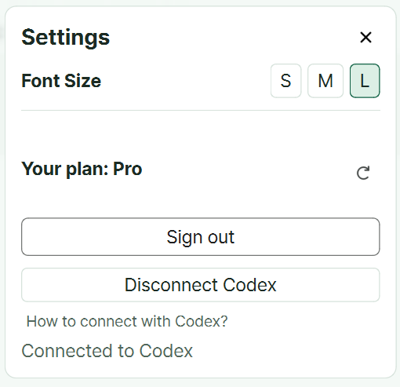
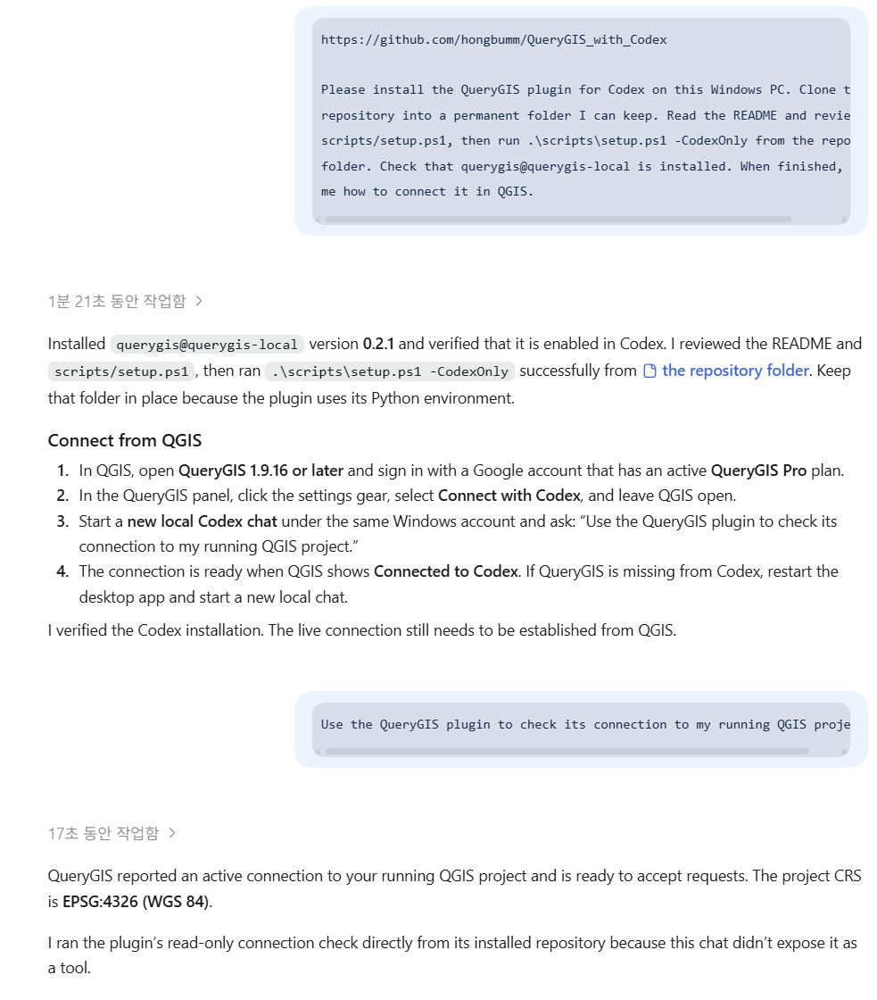
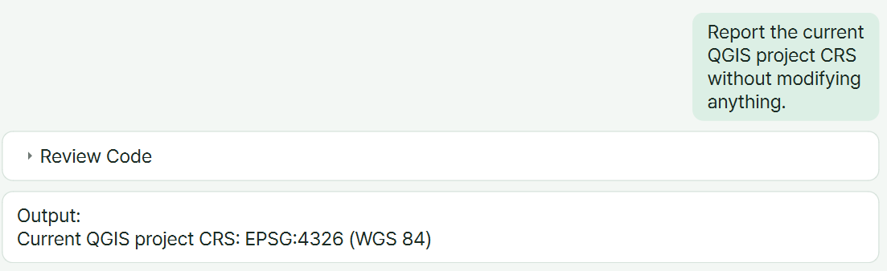

# QueryGIS for Codex

[한국어 설치 안내](README.ko.md)

Connect Codex to QueryGIS running in QGIS on the same Windows PC. You can ask Codex about the current project and send GIS requests to QueryGIS. The Codex plugin is installed locally from this repository.

## Before you start

- Install and open the Codex desktop app on Windows. Start a **local** Codex chat.
- Install [Git for Windows](https://git-scm.com/install/windows) and [Python 3.11 or later](https://www.python.org/downloads/windows/). Make sure `git`, `python`, and the Codex CLI (`codex`) are available in PowerShell.
- In QGIS, install and enable **QueryGIS 1.9.16 or later**. Sign in to QueryGIS with a **Google account on an active QueryGIS Pro plan**.
- Run QGIS and Codex under the same Windows user account.

## 1. Ask Codex to install the plugin

Copy this entire prompt, including the repository URL, into a local Codex chat.

```text
https://github.com/hongbumm/QueryGIS_with_Codex

Please install the QueryGIS plugin for Codex on this Windows PC. Clone this
repository into a permanent folder I can keep. Read the README and review
scripts/setup.ps1, then run .\scripts\setup.ps1 -CodexOnly from the repository
folder. Check that querygis@querygis-local is installed. When finished, tell
me how to connect it in QGIS.
```

Approve the requested command in Codex if prompted. Keep the cloned folder in place because the plugin uses the Python environment set up there.

<details>
<summary>Install manually with PowerShell</summary>

Run these commands from the parent folder where you want to keep the repository.

```powershell
git clone https://github.com/hongbumm/QueryGIS_with_Codex.git
Set-Location QueryGIS_with_Codex
.\scripts\setup.ps1 -CodexOnly
```

`-CodexOnly` installs the Codex side. QueryGIS 1.9.16 and later already include the QGIS connection.

</details>

## 2. Connect from QGIS

1. Open the **QueryGIS** panel in QGIS, click the settings gear, and click **Connect with Codex**. Keep QGIS open while it waits for Codex.
2. Open a **new local chat** in Codex so it loads the plugin. If the plugin is missing, restart Codex and look for **QueryGIS** under the local QueryGIS marketplace in **Plugins**.
3. Ask Codex:

   ```text
   Use the QueryGIS plugin to check its connection to my running QGIS project.
   ```

4. When QGIS shows **Connected to Codex**, the connection is ready.



<details>
<summary>See an actual Codex installation and connection check</summary>

This chat shows Codex installing QueryGIS from GitHub and then confirming the connection. In this session, Codex ran the plugin’s read-only connection check from the installed repository.



</details>

## 3. Ask about the current project

Try this in Codex once the connection is ready.

```text
Use QueryGIS to tell me the current QGIS project’s coordinate reference system
(CRS). Keep the project and its layers unchanged.
```

You can also ask in Korean, for example `지금 프로젝트 좌표계 뭐야?` The QueryGIS panel shows the request and its result. In this example, the project uses **EPSG:4326 (WGS 84)**. Your result depends on the project open in QGIS.



## Troubleshooting

- **Connect with Codex is disabled.** Check that QueryGIS is signed in via Google and displays **Your plan: Pro**.
- **QGIS is still waiting for Codex.** Ask Codex to check the connection from a new local chat. Keep both apps running on the same PC under the same user account.
- **Codex cannot find the plugin.** Confirm that setup finished successfully and restart the desktop app. If setup cannot find `python` or `codex`, check that those commands are available from PowerShell.
- **You moved the repository.** Run setup again from the new location to refresh the path to the local Python environment.
- **The old companion connector is running.** Stop its connection before connecting from QueryGIS settings. For older QueryGIS versions, see the [legacy connector instructions](README.ko.md#이전-querygis-버전-설치).

## How it works

The Codex plugin sends requests to the local QueryGIS connection. QueryGIS uses its existing authentication, selected layer context, and service. Requests that run GIS operations may change layers or files. Use Ask mode to request a plan or code preview without running it.

See [Architecture](docs/ARCHITECTURE.md) for the implementation and [Upstream projects](UPSTREAM.md) for code and asset credits.
